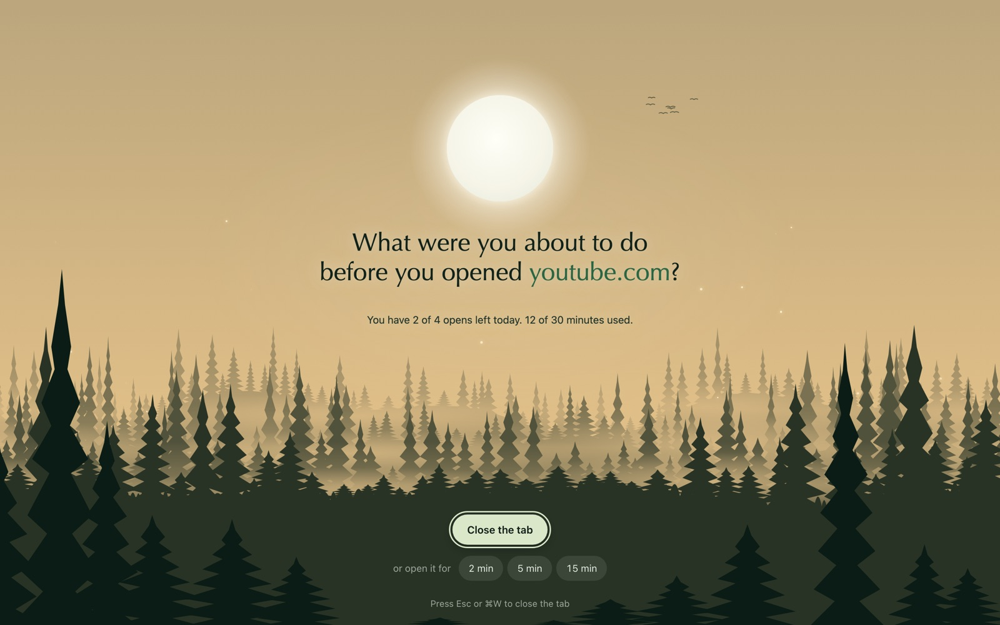
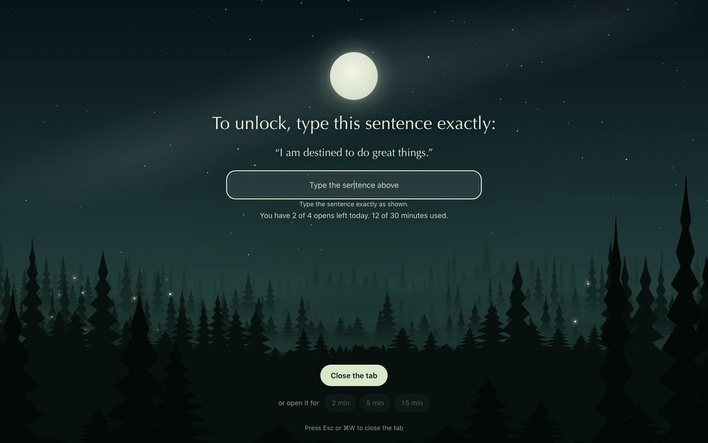
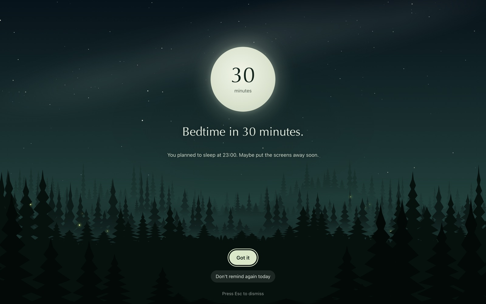
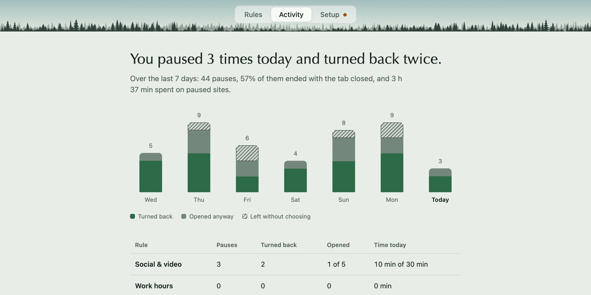
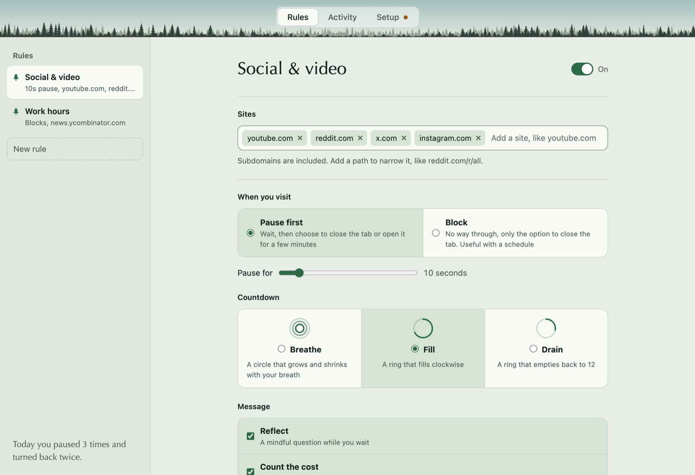

<p align="center"></p>

<h1 align="center">Defixum</h1>

<p align="center">A breath between the urge and the tab.</p>



Your hands find YouTube before you decide to go. Defixum catches that moment.

No extension. Works with Zen, Firefox, Safari, Chrome, Arc, Brave and Edge.

## Pause, then choose

A few slow breaths and one honest question. Then close the tab, or go in for 2, 5 or 15 minutes, on purpose.

Closing takes you back past every page you'd rather not be on.



For the sites that pull hardest, type a sentence first. By the time you've typed it, you've decided.

## When a pause isn't enough

- **Block** for when you already know the answer.
- **Daily limits** on visits or minutes.
- **Schedules** for work hours, weeknights, late nights.
- **Limit ⌘Tab** when your attention keeps jumping between apps.

## Sleep on time



A gentle reminder in the hours before bed, and one more at bedtime. A nudge, not a lock.

## See it working



Every day you turn back, it shows. Nothing leaves your Mac.

## A forest, not a warning

The sky follows your clock and, if you like, your local weather. Turn weather off and Defixum never touches the network.



## Install

1. Get the `.dmg` from the [latest release](https://github.com/ismayilkarimli/defixum/releases/latest). macOS 13+, Apple Silicon or Intel.
2. It isn't notarized: open it once, then **System Settings → Privacy & Security → Open Anyway**. Or:
   ```bash
   xattr -dr com.apple.quarantine /Applications/Defixum.app
   ```
3. In **Setup**, grant **Accessibility** (for Zen and Firefox). Safari and Chromium browsers ask on first use.

Defixum reads only the address of the tab in front of you. Everything stays on your Mac.

## Running it locally

**You need:** macOS 13+, the [Rust toolchain](https://rustup.rs), [Node.js](https://nodejs.org) 18+, and the Xcode Command Line Tools (`xcode-select --install`).

```bash
git clone https://github.com/ismayilkarimli/defixum.git
cd defixum
npm install
npm run dev        # run in development mode
npm run build      # build Defixum.app into src-tauri/target/release/bundle/macos
npm run release    # universal (Apple Silicon + Intel) .app and .dmg, ad-hoc signed
```

The settings window opens when you click the menu-bar icon. Set `DEFIXUM_SHOW=1` to open it on launch.

macOS ties Accessibility and Automation permissions to the app's code signature. An ad-hoc signed build loses those permissions every time you rebuild. To keep them, sign with your own certificate:

```bash
APPLE_SIGNING_IDENTITY="Apple Development: Your Name (TEAMID)" npm run build
```

To keep test data separate from your real rules, point the app at a scratch folder with `DEFIXUM_DATA=/some/folder`. Logs go to `defixum.log` in that folder.
